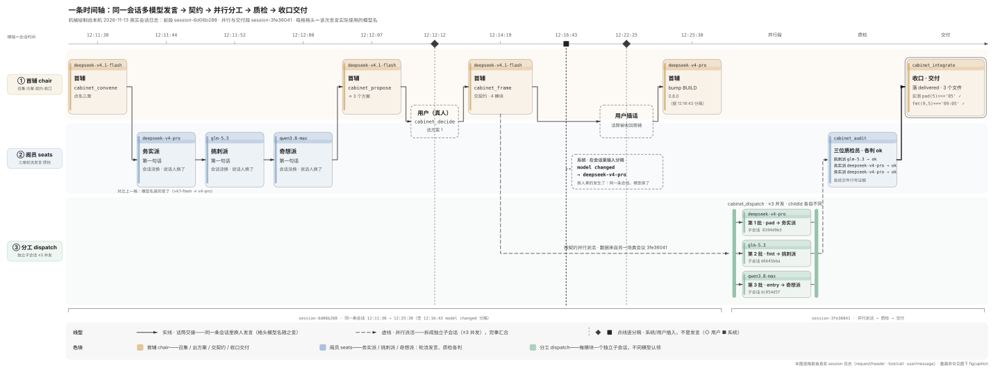

# dsh-cabinet（内阁）



在一**条对话**里开一个房间：一个模型当首辅统筹，几个不同模型的阁员当着面互相回应、争辩，吵够了收敛成 2–3 个方案（每个方案对应一派立场），你挑一个 —— 然后**按各人擅长分活、各干各的、再拼起来**。

> **重点在分工，不在辩论。** 辩论只是为了让分工有依据（谁主张什么，那部分就交给他）；真正省时间的是后面：框架 → 按依赖排批次并行干 → 机械验收 → 语义审计 → 整合。
>
> **不是轮流念稿。** 同一个会话 = 同一份上下文，后说的人看得见前面所有人说过的话；交棒时给下一位留一个**必须回答**的问题。发言都在你正在看的这条对话里，一两句一段，不糊你满屏。

> **引言截图/长图**：`docs/guide/index.html` 就是拿这个插件自己跑出来的一份图文介绍（时间轴 + 三步上手 + 真实运行记录），双击就能看。

## 安装

前提：**DSH ≥ 0.1.7-rc.1**、Node ≥ 22、能打开设置页（桌面版或 `dsh web` 都行）。

```bash
git clone https://github.com/withoutVPN/dsh-cabinet.git
```

然后在 DSH 里装上（`link:` 指本地目录，改代码不用重装）：

- 对话里让 agent 执行：`plugin_manager({ action: "install_bundle", target: "link:D:\\path\\to\\dsh-cabinet" })`
- 或者命令行：`dsh plugin --profile desktop add link:D:\path\to\dsh-cabinet`（profile 名换成你自己的）

装完刷新页面，看到两样东西就算成功：

1. 设置 → 侧栏底部多出 **「内阁」** 一页（配阁老人数 / 模型）
2. 工具列表里能搜到 `cabinet_convene`、`cabinet_dispatch` 等

> 改了 `index.js` 要重载宿主半端：先 `plugin_manager({action:"set_plugin", target:"include:cabinet", enabled:false})`，再 `enabled:true`；`GET /api/cabinet/state` 里的 `build` 字段能确认版本。改了 `client.js` 只要刷新页面（Ctrl+R）。
>
> 自检：`npm run check`（语法 + 无浏览器的 UI 冒烟，样本数据已脱敏）。

## 它怎么做到的

- 首辅 = **当前会话自己的模型**，不动。
- **席位（谁坐进来、用哪个模型）随时可定**：设置页配一套常用的；或者召集时当场点名（`cabinet_convene({topic, seats:[{model:'glm-5.3', label:'挑刺派'}], ...})`，简写 `models:["deepseek-v4-pro","glm-5.3"]`）。点名的模型不给 `provider` 时，插件会自动去各 provider 下找谁有它。
- 阁员发言前，宿主会拦 `agent/request`（每次模型调用前的瀑布），把 `provider` / `model` 换成该席位配的 —— 所以每条回复在会话里都自带"谁说的"归属，上下文也是共享的。
- **阁员发言被硬压短**：换人时 `maxTokens` 上限 2000，提示词要求"一次只打一个点、两三句、80 字以内"。要的是让你一屏看清谁在争什么，不是读报告。
- 交棒靠 `cabinet_pass`：谁说完谁点名下一位，`ask` 里写清"回应哪一句、别绕开什么"。
- 谁都能把话筒交回首辅（`to: "chair"`）；首辅拿回话筒时**不许总结**，只能挑事：指出谁和谁在哪一句上对不上，逼人回应。
- 插件会记录每一次发言（`assistant/message`），回到首辅时把最近 4 条摘要和"每人说了几次"一起给它 —— 它靠这个挑事，也靠这个判断谁还没被挑战过。
- 收敛的开关在你手里：不自动收口（`MIN_SPEECHES_BEFORE_PROPOSE = 3` 只是提示，不是强制）。
- **谁在说话，系统提示就用谁的口吻写**（`cabinet-room` section）。不这么做的话，换了模型之后它只从工具返回值里隐约知道自己是谁，常见病是开始以主持人身份报流程、或者给自己分派任务。
- **你一插话，话筒立刻收回首辅**（`user/message` 事件）：否则你这句话会被当前发言人那个阁员的模型接走 —— 你想跟主持人说话，回你的却是个阁员。

## 会场面板

左侧栏多一个「内阁」图标（在插件/schedules 图标下面一排），点开是整页会场：

- 议题、状态（议政中 / 待你挑方案 / 已派活 / 卡住了 / 已交付…）、**话筒在谁手上**
- 阁员横排，当前发言人的那个亮起来，后面跟着它用的模型
- 发言流：谁说的、哪个模型、几点、原话（最近 30 条，每 2 秒自动刷新）
- 方案卡：**可以直接点「选这个」**（走 `POST /api/cabinet/decide`），点完回对话说一句「继续」，首辅就照着这个方案做框架 —— 不用打字复述方案名
- 分工表：每个模块的席位 / 状态 / 返工次数 / 写了哪些文件 / 卡住的原因 / 质检结论
- 框架没过时会把**拼不上的那条**逐行列出来

面板数据来自 `GET /api/cabinet/state`（同一份内容，`curl` 也能看）。它只是读 + 两个动作（选方案、散会），不改任何状态机逻辑。

### 阁老在干什么（活动卡）

面板上方是一排小卡片，一人一张，**不用点开就能看出谁在忙、谁在等**：

- 首辅一张（主持），每位阁员一张：状态点 + 席位名 + 模型 + 一句话在干什么（"正在写 lib/pad.js" / "等别人先交，再写 lib/index.js" / "正在发言" / "在听，等话筒" / "卡在 X" / "已交 X"）
- 已经开了子会话的，卡片上带 `子会话 3fe36041`，可以直接对上是哪个会话
- 有模块在跑时会多一行：**N 个模块正在各自的子会话里同时跑（上限 5 个）**——这就是「一条线做不完就开多条线」的落点，不是同一个模型在打三份工
- 状态点配色：蓝=在写/在说，绿=已交，红=卡住，黄=在等，紫=在听

### 人数与模型：设置页「阁老（人数 / 每人什么模型）」

- 第一行是「人数」下拉（1–8），选完立刻增/减席位，不用一个一个加
- 每位一行：席位名 / 擅长什么（会写进它的任务提示）/ provider / 模型
- 保存后落在 `$DSH_HOME/cabinet/seats.json`，**下一次开会就按这套坐**；开会时还可以在对话里临时点名换人（只影响这一场）
- 新加席位的默认值取模型目录里第一个可用项，所以你只需要改"用哪个模型"

### 方案卡：就长在对话里

`cabinet_propose` 这一条工具调用不会显示成一行干巴巴的工具记录，它会展开成一张卡：

- 标题「内阁出方案了 · 挑一个」，下面是方案 1 / 2 / 3，每个带哪一派的立场、做什么、好在哪、代价是什么
- 直接点某项的「**选这个**」= 让首辅照这个方案写框架，不必再回一句「选 2」
- 选完这张卡会记住（被选的高亮、其余变灰、按钮禁用），下次滚到这里还是这个状态
- 实现：`client.js` 往 `tool.call.toolview`（key = `cabinet_propose`）注册了一个视图，读 `/api/cabinet/state` 里本会话的那场会；点击打 `POST /api/cabinet/decide {via:'chat'}`

## 用法

1. 设置 → **内阁**：配 2–8 位阁员（席位名 / 擅长什么 / 用哪个模型），保存。配置存在 `$DSH_HOME/cabinet/seats.json`。
2. 在对话里说：**「开个内阁讨论一下：<你的议题>」**。想当场定阵容就在同一句里点名：**「开个内阁，叫 deepseek-v4-pro、glm-5.3、qwen3.8-max 吵一下：<议题>」** —— 首辅会把这三个模型拉进来，名字当席位名，provider 自动找。
3. 首辅开题 → 点名开吵 → 谁不服就点谁 → 中途你随时可以插话改议程。**所有发言都在这个对话页里**，一句话一段，方便你顺着读。
4. 你说「出方案」→ 他给 2–3 个方案（标好是哪一派的立场）→ **方案卡就在这条对话里**：「cabinet_propose」那次工具调用会展开成一张可点的列表，点「选这个」即可；也可以回一句「选 2」。侧栏面板里同样能点。
5. 你说「散了吧」→ 收摊。

## 工具

| 工具 | 谁用 | 干什么 |
| --- | --- | --- |
| `cabinet_convene` | 首辅 | 开会，摆议题，列出阁员，给出"怎么吵"的规则；可带 `seats`/`models` 当场指定这次谁坐进来 |
| `cabinet_pass` | 所有发言人 | 交话筒（阁员 id 或 `chair`），`ask` = 给下一位的必答题 |
| `cabinet_yield` | — | 旧名字，只会提示改用 `cabinet_pass` |
| `cabinet_propose` | 首辅 | 收敛成 2–3 个方案，停机等你挑 |
| `cabinet_decide` | 首辅 | 锁定你挑的方案（proposed → decided），并告诉首辅"框架该写什么" |
| `cabinet_frame` | 首辅 | 提交**机器可读的框架**；立刻跑静态检查，不过就退回 |
| `cabinet_dispatch` | 首辅 | 按框架派活（每模块一个独立子会话，跑该模块**被指派那位阁老**的模型，**按 imports 依赖分批**，一批最多 5 个同时）；收齐后自动做机械验收 |
| `cabinet_audit` | 首辅 | 交付前验收：**首辅自己**读各模块交出来的东西，只看接缝会不会断（阁员不审阁员） |
| `cabinet_integrate` | 首辅 | 全绿才允许交付，落交付说明 |
| `cabinet_status` | 任意 | 议题、状态、现在轮到谁、每人说了几次 |
| `cabinet_close` | 任意 | 散会 |

## 第二阶段：框架 → 并行 → 拼接审计 → 整合

```
debate ──(你挑方案)──> decided ──(frame 通过)──> framed ──(你点头)──> dispatched
                                  ↑                                        │
                                  └──── blocked ←── 机械/语义检查不过 ───────┘
                                                                           │
                                              integrating ──(integrate)──> delivered
```

1. 你说「就 1」→ 首辅调 `cabinet_decide`。
2. 首辅调 `cabinet_frame({contract})` 交框架。contract 长这样：

```json
{ "goal": "…",
  "moduleSystem": "esm",
  "modules": [{ "id": "add", "title": "加法模块", "seat": "s1",
                "writes": ["lib/a.js"],
                "exports": [{ "kind": "symbol", "from": "lib/a.js",
                              "name": "add", "signature": "add(a: number, b: number): number" }],
                "imports": [{ "from": "mul", "symbol": "mul",
                              "signature": "mul(a: number, b: number): number",
                              "specifier": "./mul.js" }],
                "acceptance": ["导出 add(a,b)"] }],
  "integration": { "entry": "lib/index.js", "how": "re-export 两个模块" },
  "verify": { "module": "node -e \"import('./{file}').then(m => m.add(1,2) === 3)\"",
              "all": "node -e \"import('./{entry}').then(m => m.add(1,2) === 3)\"" } }
```

3. **提交那一刻就跑静态检查**（纯函数，不花模型钱）：模块 id 唯一 / 写域两两不相交 / 每个 symbol 出口都写了 `from` + `signature` / imports 的签名与目标出口**归一化后逐字相等** / imports 的 `specifier` 以 `.` 开头且真能解析到目标文件 / 出口的落点（`file` 和 `symbol` 都查）必须在自己写域内 / **出口名跨模块不能重名**（入口 `export *` 会变成歧义）/ 依赖图无环 / **入口必须有人接**（落在某模块写域，或 `integration.owner: "chair"` 明写首辅自己接）/ **`verify.all` 必填**。有硬错误直接退回，逐条列出哪里拼不上、差在哪个参数。
4. **先落骨架，再派活**：`cabinet_dispatch` 在起子会话前由插件自己写 `contract.json`、每个出口的 stub（签名 + `throw new Error('cabinet stub: … 还没实现')`）、入口聚合文件，必要时补 `package.json`。**已存在的文件绝不覆盖**：目标文件一定存在，写的时候就编译得过。
5. 你点头 → `cabinet_dispatch`：每个模块一个**独立子会话**，用它**被指派那位阁老**的模型（不是首辅的模型在替所有人写）。**批次按 imports 依赖推**：谁都不等谁的那些先开（一批最多 5 个），`fmt` 依赖 `pad` 就等 `pad` 交出真实文件再动手 —— 不让谁对着还不存在的接口盲写。开工前先把分工表摆出来（哪个模块、谁做、擅长什么、写哪些文件、等谁先交）。每个子会话都被明确告知：你是谁、自己的写域、别人的地盘一个字别动、每个出口的**签名原文**与每条依赖的**现成 specifier**、做完跑 `verify.module` 并把 `checks` 写进回执。
6. 收齐后自动做**机械验收**：文件在不在、有没有越界写、承诺导出的 symbol 有没有真出现、**代码里真写下的每个相对 import 是否落在写域或 declared 依赖的出口上**（自己猜路径拼错的，这一条就拦住）。不合格的模块标 `blocked` 并给出具体差异 —— 这些差异就是"拼不上"的位置。
7. 全绿后按 `verify.all` **真跑一次拼装**（不是读文本猜）：退出码非 0 直接 blocked 并贴 stdout/stderr 尾巴；只有 `verify.ok === true` 才允许下一步。
8. `cabinet_audit`：**由首辅本人验收**（首辅这一场用的模型，从 `chairCfg` 取），只看"别人按契约接上去会不会断"（签名、命名、单位、错误处理、字段名），不看风格。它交白卷（没有 verdict）会被重问一次；仍然交白卷就明写"这条没被真正审过"——**"没审"不会被说成"没问题"**，收尾会报"3/2 审过、1 个没审"。
9. `cabinet_integrate` 交付：**没有真跑过的验收结果直接拒绝**；`ok === null`（manual 模式）要求首辅自己写清验过什么；**合约里有模块没派过（只跑过 `only` 的一部分）也拒绝**。
10. 返工**只重派失败的那几个**：`cabinet_dispatch({ only: ["mul"] })`。

**为什么不是让首辅自由发挥**：并行最容易死在"各干各的、拼不上"。所以写哪里、交什么、依赖谁，必须先变成数据、先被机械校验过；能机械查出来的，绝不让模型去猜。

## 坑（踩过的）

- **席位必须指向当前对话在用的那个 provider**。指到别的 provider（比如一个没登录的账号型 provider）时，换模型那一步会让整个回合直接挂掉——表现是"说着说着没反应了"。
- **模块系统混用是并行开发的头号杀手**：三个人各写各的，一个用 `export function`、一个用 `module.exports`，单独看都对，`import` 一接就炸。所以机械验收会逐个文件判 ESM/CommonJS，**混了就一律 blocked**，并说明是哪一种对不上；契约里也可以写 `moduleSystem: "esm" | "cjs"` 把要求直接塞进每个子会话的任务提示。
- **项目级声明没人认领**：三个文件彼此都是 ESM，不等于"这个目录被当成 ESM"。目录里没有 `package.json` 时靠 Node ≥22.7 的语法探测兜着；被挪进 `"type": "commonjs"` 的包里立刻全炸。契约里没有模块的写域包含 `package.json`，所以收活后会额外查一次最近的 `package.json` 的 `type`，对不上就警告。
- **别用 PowerShell 5.1 或记事本改 `seats.json`**：它们会写 UTF-8 BOM，`JSON.parse` 直接抛错，然后整份配置被当成空（表现为"0 位阁员"）。代码里已经会剥 BOM，但用设置页改最稳。
- **子会话也必须显式带 `reasoningEffort`**：只给 `{provider, model}` 时适配器会把 `enable_thinking` 发成 false，glm-5.3 直接 400（`The value of the enable_thinking parameter is restricted to True.`），子会话 `stopReason=error`、活没干、回执也没有。派活前会按 `llm.resolveModelInfo` 的能力表给它挑一档合法档位。
- **别用"删字段"的方式改模型配置**：`delete cfg.reasoningEffort` 会被适配器翻译成"显式关掉思考"，同样 400。要改就显式给值。
- 会场状态落盘在 `$DSH_HOME/cabinet/debates.json`（每次工具调用后 0.4 秒写入）：**宿主重载/进程重启不会把在飞的会弄丢**，重载后接着说就行。超过 6 小时没动静的旧会不再恢复；散会（`cabinet_close`）会把它从文件里删掉。
- **议政中的阁员只能说话**：除 `cabinet_pass` / `cabinet_status` / `read` / `grep` / `glob` / `web_search` / `web_fetch` 之外的任何工具都会被**同步否决**（不是靠提示词，是 `ctx.tools.guard` 硬拦，报错原文写"你越权了"）。改文件、派活、出方案、散会都归首辅和用户。
- **单个模块返工上限 2 轮**：第 3 次 `only:[id]` 会被拒绝（`done` 的模块也一样算，没有后门），并让首辅停下来问你——是改契约、换个人写、还是砍掉。不让它自己换策略硬冲。
- 谁端着话筒没交棒就结束了回合（模型忘了调工具），`turn/end` 会把话筒自动收回首辅，避免整屋子人卡在一个人身上。
- **接棒的人最容易犯的错是"当旁白"**：它看见历史里有一条"话筒交给务实派"的工具调用，会以为那是自己干的，于是回一句"话筒已交 s1，等待发言"。所以 `cabinet_pass` 的返回文案是**对着接棒人**写的，第一句就拆掉这个误会（"上面那次 cabinet_pass 不是你做的"），并且明令禁止流程旁白（"话筒已交…""等待…发言""当前进度"）。
- **"按擅长分工"是硬检查，不是口号**：框架里每个模块的 `seat` 必须是本场真实席位（写 `s9` 直接退回，并列出"现有：s1 / s2"）；所有人都被塞了活、只有一个人闲着时给一条警告（"别把活堆给同一个人"）。派活时每个子会话的任务提示里都会写明"派给你的人是谁、首辅按你的擅长指派了什么"，分工表和派活表也逐条带"擅长 …"。`cabinet_convene` 用 `models:[…]` 简写点名时，会自动从设置页那几位身上继承 `label` 和 `skill` —— 否则"按擅长分"没东西可分。
- **派活前先确认工作区存在**：cwd 指向不存在的目录时，子会话在启动阶段就失败（回执 `working-directory: directory does not exist`、`files` 为空），模块直接 blocked。`cabinet_dispatch` 现在会先查目录，不存在就直接拒绝，不白开一圈子会话。
- **并行 ≠ 同时开工**：`fmt` 依赖 `pad` 时必须等 `pad` 交出真实文件再动手，否则它是在对着一个还不存在的接口盲写。派活批次按 `imports` 推导（谁都不等谁的一批最多 5 个），并且开工前先把分工表摆给你看（模块 / 谁做 / 擅长什么 / 写哪些文件 / 等谁先交）。
- 一场最多 40 次发言（`MAX_SPEECHES`），到顶强制回首辅收口。
- 换人是在请求层硬改配置，所以**同一个会话里跨 provider 的历史回放**依赖宿主既有能力，不是这个插件造的。
- **换模型的监听必须 `prepend`**：`agent/request` 的替换会被"当前会话选中的模型"那一层改回去（只漏过 `maxTokens` 这类它不管的字段）。所以监听注册成 `ctx.on('agent/request', fn, { global: true, prepend: true })`，排在最前面、先 `await next()` 拿到别人钉过的配置，再覆盖 `model`/`provider`。判据：会话里出现 `[model changed: … deepseek-v4-pro …]` 分隔。
- **`/models` 的返回形状别想当然**（0.8.2 修）：宿主给的是模型对象，客户端却按 `m.id / m.name` 取——本来没问题，但服务端把每项压成了字符串 `String(m?.id ?? m?.model ?? m)`，于是下拉框里 `value` 和文案全是 `undefined`，**渲染出一排空白项**。现在服务端统一回 `{id,name}` 并带上 provider 的友好名，客户端还做了兜底（字符串也认、当前值不在列表时补一条「（当前）」、provider 没报模型列表时改成手填输入框），保存前也会拦下空 model。
- **派活的工作区必须显式给**：`ToolRunContext` 上没有 `cwd`，`process.cwd()` 在桌面版里就是 `$DSH_HOME/profiles/desktop`——第一轮 dispatch 就把四个文件写进了 DSH 自己的配置目录，而机械验收在同一个错目录里核对，于是"全部通过"。现在解析顺序是 `args.cwd → 本场会记住的 cwd → 会话 meta.cwd`，并且**只要落在 `$DSH_HOME` 里就直接拒绝执行**，让你显式传项目目录。
- **契约里的"背景材料"（`brief`）必须自己先核对**：我凭记忆写了几行"日志原文"给 record 模块，它照着编进了"真实运行记录"，被质检逐条对日志抓出来（`turn:3` 那次 completed 比 convene 早两小时、三条 MSG 在全部会话里 0 命中）。凡是标"原样摘录"的东西，派活前先自己 grep 一遍。
- **0.9 修的三件事，都是 0.8.6 真踩过的**：① 出口只写名字不写形状，`render(el, data)` 被当成 `render(data)` 调，静态检查看着全对；现在 `signature` 必填、逐字比对。② 入口没人认领，验收之后才手写，从来没被审过；现在入口无主直接退回，或明写 `owner: "chair"` 由首辅接。③ 验收只读文本不跑代码，第一次 `import` 发生在交付之后；现在按 `verify.all` 真跑，不跑过不许交付。
- **stub 是插件替你先落的**：每个出口文件里那句 `throw new Error('cabinet stub: … 还没实现')` 是脚手架写的，阁老必须把它换成实现；模块自检和整体 `verify.all` 都会当场炸——这正是 0.9 想要的"写的时候就编译得过，跑的时候就露馅"。
- **0.9.1 自审补的洞**：① 出口名跨模块重名（入口 `export *` 歧义，两边单测都绿、一 import 就炸）现在在提交契约时直接拦；② symbol 出口的 `from` 以前不查写域归属，只在收活时以"越界/缺文件"暴露，现在提交时就报；③ 签名解析认 `render: (a, b) => T`、`async f()`、`map<T>(…)` 这几种写法，回调参数 `cb: (x) => void` 里的 `=>` 也不再切乱参数；④ `cabinet_integrate` 补齐"有模块压根没派过就交付"的闸门；⑤ 只重派部分模块时，收尾按**整张表**判"全部通过"，不会被这一批全绿骗过去。
- **type / interface 出口（0.9.2 起支持）**：写成 `{"kind":"type","name":"TreeNode","from":"types.ts","signature":"type TreeNode = { id: string }"}`，只许落在 `.ts/.tsx/.mts/.cts` 文件里；骨架会落一个 `export type TreeNode = never`（**不是**运行时 stub，探针也不会去调用它）；依赖方的 `signature` 归一化后必须与它逐字相等。JS 项目里没有类型出口这回事，写进去会直接被拦。
- **0.9.2 另外两刀**：① 真跑改成异步 `spawn` 并带超时终止（Windows 上补 `taskkill /T`）——以前 `spawnSync` 跑一条 `npm test` 会把整个宿主卡住最长 240 秒；② 模块自检模板若用 `{file}`，模块交了几个代码文件就逐个跑几遍，不再只探第一个（只探第一个时，第二个文件里坏掉的 import 永远没人发现）。
- **import 路径要照抄契约给的 `specifier`**：`./a.js` 还是 `../lib/a.js`，从不同文件出发不一样；收活时会读代码里真写下的相对路径，指到不存在的文件或别人的地盘就 blocked。
- **声明了依赖，代码里却一次都没出现那个符号 → 收活直接算错（0.9.2）**：契约上接得再漂亮，运行时没写 `import` 就是没接上。它拦不住"import 了却没用/用错"，那归质检员；但拦得住"压根没接"。
- 改了 `index.js` 之后宿主不会自动重载，要 `set_plugin` 关一次再开一次（见下）。

## 图文介绍（这份介绍是内阁做的）

`docs/guide/index.html`（直接双击打开）不是手写的：它是用这个插件跑出来的一场会 —— 奇想派画时间轴、务实派写三步上手、挑刺派扒真实日志、务实派收口拼页，两批并行（3 个 frag 同时 → 拼页），中间被质检打回过两轮（"原样摘录"对不上日志、`build.mjs` 拿 `index.html` 当模板把自己写空）。

改内容只改 `frag-*.html`，然后重跑：

```
node dsh-cabinet/docs/guide/build.mjs
```

`build.mjs` 自带 HTML 壳，只读三个 frag 填 `<!-- FRAG:* -->`，**不读 `index.html` 当输入**——所以删掉页面重跑也能重建，给 frag 加一行重跑也一定进得去。

## 开发

```
dsh-cabinet/
  package.json        # bundle 元数据 + dsh.client 注入
  cordis.patch.yml    # insert 一个 id=cabinet 的条目
  index.js            # host 半端：工具 + agent/request 拦截 + 发言记录 + /api/cabinet
  client.js           # 浏览器半端：设置页 + 会场面板（__ModuleLoader__ 自注册脚本，无 JSX）
  smoke.cjs           # 冒烟：用假的 React 把面板/设置页/方案卡的各种状态真的执行一遍（npm run smoke）
  samples/            # 冒烟用的样本数据（已脱敏：字段是真的，议题和发言都换过）
  docs/guide/         # 上图那份介绍（build.mjs + 三个 frag + 产物 index.html）
  DESIGN.md           # 设计稿：状态机 / 契约字段 / 三层检查
  LICENSE             # MIT
```

改了 `index.js` 之后要重载模块才生效：

```
plugin_manager set_plugin { action: set_plugin, target: "include:cabinet", enabled: false }
plugin_manager set_plugin { action: set_plugin, target: "include:cabinet", enabled: true }
```

`GET /api/cabinet/state` 会带 `build` 字段，用来确认宿主真的重载了；另外还会带 `lastSpeeches`、`frameIssues`、`dispatch.modules`（每个模块的 status / files / issues / audit / childId）、`delivered` —— 排查"到底卡在哪一步"主要看它。